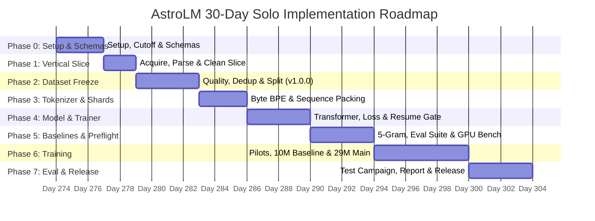

# AstroLM — 30-Day Solo Implementation Plan & Daily Execution Guide

**Solo Engineer Operating Manual**: You own every aspect of this research and engineering pipeline—data collection, tokenizer training, transformer implementation, training loop, hardware optimization, baseline comparisons, evaluation, and documentation. 

This document defines the day-by-day blueprint for all 30 days. For each day, it specifies:
1. **Focus & Objective**: What needs to be accomplished and why.
2. **Detailed Instructions**: The technical steps, design rules, and constraints to respect.
3. **Task Checklist**: Specific actionable tasks to complete.
4. **End-of-Day Output & Gate Checks**: Tangible artifacts produced and validation criteria that must pass before advancing.
5. **Humanized Git Commit Instructions**: Obvious, natural commit messages for intermediate milestones and end-of-day commits (strictly avoiding generic AI boilerplate like `feat: add stuff` or `fix: bug`).

---

## Operating Rules for the 30-Day Plan

- **Sequential Execution**: Do not begin a day without passing the end-of-day checks of the preceding day.
- **Strict Data Isolation**: Never allow validation or test documents into tokenizer training, hyperparameter tuning, or prompt design.
- **No Fictitious Results**: All reported numbers, token counts, losses, VRAM readings, and times must be measured and recorded.
- **Commit Discipline**: Commit after each completed task or logical unit of work using clear, descriptive, humanized commit messages.

---

# Week 1: Foundations, Schemas & Data Pipeline

---

### Day 1: Project Setup, Scope Lock & Temporal Cutoff

#### 1. Focus & Objective
Establish the repository structure, configure source controls, record the research question and success criteria, define the UTC temporal cutoff, and configure the initial data source allowlist.

#### 2. Detailed Instructions
- Read all core specifications (`PRD.md`, `ARCHITECTURE.md`, `DATASET.md`, `ROADMAP.md`).
- Set up directory trees for modular packages: `src/astrolm/` (`data`, `tokenizer`, `model`, `training`, `baselines`, `evaluation`, `utils`), `configs/`, `manifests/`, `schemas/`, `tests/`, `reports/`, `worklog/`, and `experiments/decisions/`.
- Verify `.gitignore` ignores large data files (`data/`, `shards/`, `raw/`), model checkpoints (`checkpoints/`, `runs/`, `*.pt`), and virtual environments (`.venv/`).
- Establish a UTC temporal cutoff (`configs/data/sources.yaml`), e.g., `2024-01-01T00:00:00Z`. Any source document published or revised after this timestamp is excluded from training, validation, and test sets.
- Define source statuses: OpenStax Astronomy 2e (approved), English Wikipedia Astronomy dump (approved), NASA APOD (conditional on rights audit), ESA & Astronomy Stack Exchange (excluded from baseline).
- Initialize the decision log and Day 1 worklog.

#### 3. Task Checklist
- [ ] Create folder structure for `src/astrolm/`, `configs/`, `manifests/`, `tests/`, `reports/`, and `worklog/`.
- [ ] Verify and update `.gitignore` to prevent committing raw data, checkpoints, binary shards, or secrets.
- [ ] Draft initial `README.md` summarizing the project, research question, hardware constraints, and non-goals.
- [ ] Create `configs/data/sources.yaml` defining source allowlist and the UTC temporal cutoff timestamp.
- [ ] Record the first project decision in `experiments/decisions/001-temporal-cutoff.md`.
- [ ] Create `worklog/day-01.md` documenting Day 1 setup and scope confirmation.

#### 4. End-of-Day Output & Gate Checks
- **Artifacts**: Clean repository skeleton, updated `.gitignore`, `configs/data/sources.yaml`, `experiments/decisions/001-temporal-cutoff.md`, `worklog/day-01.md`.
- **Gate Check**: Directory structure intact; `.gitignore` verified with `git status` ignoring dummy `.pt` and `data/` files; temporal cutoff and source allowlist explicitly documented.

#### 5. Commit Instructions
- **Task Commit 1**: 
  ```bash
  git add .gitignore README.md
  git commit -m "Set up project directory layout and gitignore rules for data and checkpoints"
  ```
- **Task Commit 2**: 
  ```bash
  git add configs/ experiments/ worklog/
  git commit -m "Define initial source allowlist and document temporal cutoff rule for Day 1"
  ```

---

### Day 2: Environment Pinning, Hardware Probing & Authored Fixtures

#### 1. Focus & Objective
Pin the Python development environment, capture exact hardware and driver specifications, define metadata schemas for documents, and author tricky astronomy regression fixtures.

#### 2. Detailed Instructions
- Set up a clean virtual environment and generate a locked dependency file (`requirements.lock` or `requirements.txt` with pinned versions) including `torch`, `tokenizers`, `jsonschema`, `pytest`, and `pyyaml`.
- Write `scripts/environment.py` to inspect and log the machine specs: ASUS TUF Gaming F15, Intel i7-12700H, RTX 3050 (4GB VRAM), 16GB system RAM, OS version, NVIDIA driver version, CUDA runtime, and PyTorch build.
- Create `schemas/document.schema.json` enforcing mandatory metadata: `document_id`, `source`, `canonical_url`, `revision_id`, `published_at`, `retrieved_at`, `author_attribution`, `license_id`, `raw_sha256`, `clean_sha256`, and `split`.
- Create `configs/seeds.yaml` with explicit named seeds for data split, deduplication sampling, tokenizer training, model initialization, data shuffling, and evaluation.
- Author synthetic astronomy fixtures (`tests/fixtures/astronomy_sample.jsonl`) containing tricky syntax: Greek letters ($\alpha$ Centauri, $\beta$ Pictoris), units ($M_\odot, \text{km/s}, \text{pc}$), coordinates (RA/Dec), negative signs ($-2.5$), catalog designations (NGC 1300, M31), and duplicates.

#### 3. Task Checklist
- [ ] Pin dependencies and generate locked requirements file.
- [ ] Implement `scripts/environment.py` and output `reports/environment.json`.
- [ ] Define JSON schema in `schemas/document.schema.json` matching `DATASET.md`.
- [ ] Configure named seeds in `configs/seeds.yaml`.
- [ ] Author synthetic fixture records in `tests/fixtures/astronomy_sample.jsonl`.
- [ ] Write unit test `tests/data/test_schema.py` to validate fixtures against the JSON schema.
- [ ] Record day summary in `worklog/day-02.md`.

#### 4. End-of-Day Output & Gate Checks
- **Artifacts**: `requirements.lock`, `scripts/environment.py`, `reports/environment.json`, `schemas/document.schema.json`, `configs/seeds.yaml`, `tests/fixtures/astronomy_sample.jsonl`, `worklog/day-02.md`.
- **Gate Check**: `pytest tests/data/test_schema.py` passes; hardware report correctly displays GPU VRAM and CUDA versions; zero missing metadata fields in fixtures.

#### 5. Commit Instructions
- **Task Commit 1**: 
  ```bash
  git add requirements.lock scripts/environment.py reports/environment.json
  git commit -m "Add hardware environment probe and freeze project dependency versions"
  ```
- **Task Commit 2**: 
  ```bash
  git add schemas/ configs/seeds.yaml tests/ worklog/
  git commit -m "Define document metadata schema and author raw astronomy regression fixtures for Day 2"
  ```

---

### Day 3: Contracts, Evaluation Protocols & Experiment Registration

#### 1. Focus & Objective
Formalize protocol specifications and programmatic contracts before training any models. Define evaluation rules, bits-per-byte calculations, baseline comparison criteria, and experiment schemas.

#### 2. Detailed Instructions
- Draft `configs/eval/protocol.yaml`: define UTF-8 byte accounting rules (treating `<eos>` as carrying 0 text bytes and `<pad>` having 0 loss weight), token-weighted negative log-likelihood (NLL) aggregation, perplexity formulas, and bootstrap confidence intervals.
- Define early stopping rules: stop training if validation NLL worsens at two consecutive validation checks while training loss decreases.
- Define tie-breaking rules: when validation BPB differences are statistically insignificant, prefer earlier checkpoints with lower compute cost.
- Define programmatic interfaces in `src/astrolm/contracts/` for datasets, tokenizers, models, and trainers.
- Create `schemas/experiment.schema.json` matching the registration format in `EXPERIMENTS.md`.
- Record Day 3 worklog.

#### 3. Task Checklist
- [ ] Write `configs/eval/protocol.yaml` specifying BPB metrics, stopping rules, and tie-breakers.
- [ ] Implement protocol schema in `schemas/experiment.schema.json`.
- [ ] Define interface stubs in `src/astrolm/contracts/` (`data_contract.py`, `model_contract.py`, `eval_contract.py`).
- [ ] Document numerical tolerance thresholds for FP32/FP16 evaluations.
- [ ] Record day summary in `worklog/day-03.md`.

#### 4. End-of-Day Output & Gate Checks
- **Artifacts**: `configs/eval/protocol.yaml`, `schemas/experiment.schema.json`, `src/astrolm/contracts/`, `worklog/day-03.md`.
- **Gate Check**: Protocols and schemas validate; clear mathematical definitions for token-weighted NLL and BPB documented before any model runs.

#### 5. Commit Instructions
- **Task Commit 1**: 
  ```bash
  git add src/astrolm/contracts/ schemas/experiment.schema.json
  git commit -m "Draft interface contracts and experiment registration schema"
  ```
- **Task Commit 2**: 
  ```bash
  git add configs/eval/ worklog/
  git commit -m "Lock evaluation protocols and baseline comparison rules for Day 3"
  ```

---

### Day 4: Source Acquisition & Provenance Tracking

#### 1. Focus & Objective
Build acquisition scripts and source adapters to download a small, approved sample of OpenStax and Wikipedia astronomy articles while capturing immutable provenance and checksums.

#### 2. Detailed Instructions
- Build `src/astrolm/data/acquire.py` with HTTP request handling, rate limiting, and SHA-256 calculation.
- Implement source adapters in `src/astrolm/data/adapters/`:
  - `openstax.py`: Handle section and chapter retrieval, retaining book edition and CC-BY 4.0 license metadata.
  - `wikipedia.py`: Handle Wikipedia API / dump records, capturing revision IDs, page titles, and CC-BY-SA 4.0 license metadata.
- Fetch a small real sample (<50 articles) and write raw JSONL records to local disk (outside git or in staging).
- Generate `manifests/sources/raw_manifest.jsonl` containing metadata without full copyrighted text.
- Write tests to verify stable ID generation (`doc_{source}_{record_id}`) and SHA-256 hashing.

#### 3. Task Checklist
- [ ] Implement `src/astrolm/data/acquire.py` with rate limiting and hash generation.
- [ ] Implement OpenStax and Wikipedia adapters in `src/astrolm/data/adapters/`.
- [ ] Fetch small approved sample and generate `manifests/sources/raw_manifest.jsonl`.
- [ ] Write unit tests in `tests/data/test_acquire.py` validating provenance fields and SHA-256 computation.
- [ ] Record day summary in `worklog/day-04.md`.

#### 4. End-of-Day Output & Gate Checks
- **Artifacts**: `src/astrolm/data/acquire.py`, `src/astrolm/data/adapters/`, `manifests/sources/raw_manifest.jsonl`, `tests/data/test_acquire.py`, `worklog/day-04.md`.
- **Gate Check**: `pytest tests/data/test_acquire.py` passes; all downloaded records satisfy temporal cutoff; zero missing provenance fields.

#### 5. Commit Instructions
- **Task Commit 1**: 
  ```bash
  git add src/astrolm/data/acquire.py src/astrolm/data/adapters/
  git commit -m "Implement data acquisition adapters with strict provenance logging"
  ```
- **Task Commit 2**: 
  ```bash
  git add manifests/sources/ tests/data/ worklog/
  git commit -m "Collect initial OpenStax and Wikipedia test sample with raw manifests for Day 4"
  ```

---

### Day 5: Parsing, Normalization & Cleaning Pipeline

#### 1. Focus & Objective
Implement source-specific text extraction and Unicode normalization that strips boilerplate while preserving critical scientific notation, symbols, and formatting.

#### 2. Detailed Instructions
- Build `src/astrolm/data/parse.py` to extract article prose while preserving section headings for context.
- Implement boilerplate removal tailored to each source (navigation boxes, citation markers `[1]`, edit links, external links, image captions without context).
- Build `src/astrolm/data/normalize.py`:
  - Decode HTML entities.
  - Apply Unicode NFC normalization.
  - Normalize excessive whitespace and consecutive newlines.
  - Strictly preserve case, Greek letters ($\alpha, \beta, \gamma$), mathematical symbols ($\pm, \times$), negative exponents, coordinates ($12^{\text{h}} 30^{\text{m}}$), and astronomical units ($M_\odot, L_\odot, \text{AU}$).
- Write tests in `tests/data/test_normalize.py` using synthetic fixtures to ensure astronomy notation is never corrupted.
- Verify idempotence: running cleaning twice on the same raw file yields identical SHA-256 hashes.

#### 3. Task Checklist
- [ ] Implement HTML/Wiki text parsers in `src/astrolm/data/parse.py`.
- [ ] Implement conservative normalizer in `src/astrolm/data/normalize.py`.
- [ ] Process raw sample and produce clean text in staging and `manifests/clean/clean_manifest.jsonl`.
- [ ] Write parser regression tests in `tests/data/test_normalize.py`.
- [ ] Test clean text idempotence across multiple runs.
- [ ] Record day summary in `worklog/day-05.md`.

#### 4. End-of-Day Output & Gate Checks
- **Artifacts**: `src/astrolm/data/parse.py`, `src/astrolm/data/normalize.py`, `manifests/clean/clean_manifest.jsonl`, `tests/data/test_normalize.py`, `worklog/day-05.md`.
- **Gate Check (Vertical Slice Gate)**: Raw $\rightarrow$ clean pipeline executes seamlessly; astronomy notation preserved 100%; hash idempotence verified.

#### 5. Commit Instructions
- **Task Commit 1**: 
  ```bash
  git add src/astrolm/data/parse.py src/astrolm/data/normalize.py
  git commit -m "Build prose extraction and astronomy-preserving text normalization pipeline"
  ```
- **Task Commit 2**: 
  ```bash
  git add tests/data/test_normalize.py manifests/clean/ worklog/
  git commit -m "Add parser regression tests and verify clean sample provenance for Day 5"
  ```

---

### Day 6: Quality Filtering & Calibration

#### 1. Focus & Objective
Implement quantifiable quality filtering rules, calibrate thresholds on a labeled sample, and process the full source collection candidate.

#### 2. Detailed Instructions
- Implement `src/astrolm/data/quality.py` with quantifiable rejection filters:
  - Prose character length (reject fragments < 200 characters).
  - Paragraph count (reject single disconnected fragments).
  - Alphabetic character ratio (reject noisy markup/tables).
  - Markup contamination (HTML tags, unparsed template syntax).
  - Repeated line ratio (reject boilerplate footer/header loops).
  - Language detection confidence (English text with confidence $\ge 0.90$).
- Label a calibration set of 50 accepted and 50 rejected records across sources.
- Store calibrated threshold parameters in `configs/data/quality.yaml`.
- Run quality filtering on the acquired corpus, recording explicit rejection reasons for every excluded record.
- Generate a quality audit summary in `reports/data/calibration_report.json`.

#### 3. Task Checklist
- [ ] Implement quality filter checks in `src/astrolm/data/quality.py`.
- [ ] Label 50 accepted and 50 rejected records for calibration.
- [ ] Store finalized thresholds in `configs/data/quality.yaml`.
- [ ] Execute quality filtering on candidate documents.
- [ ] Output filtering audit and rejection reasons to `reports/data/calibration_report.json`.
- [ ] Record day summary in `worklog/day-06.md`.

#### 4. End-of-Day Output & Gate Checks
- **Artifacts**: `src/astrolm/data/quality.py`, `configs/data/quality.yaml`, `reports/data/calibration_report.json`, `worklog/day-06.md`.
- **Gate Check**: Calibrated quality filters achieve zero false rejections on astronomy test fixtures; all rejected records have documented rejection reasons.

#### 5. Commit Instructions
- **Task Commit 1**: 
  ```bash
  git add src/astrolm/data/quality.py configs/data/quality.yaml
  git commit -m "Implement quality filtering rules and calibrate rejection thresholds"
  ```
- **Task Commit 2**: 
  ```bash
  git add reports/data/ worklog/
  git commit -m "Execute quality filtering on candidate corpus with full audit logs for Day 6"
  ```

---

### Day 7: Global Deduplication & Clustering

#### 1. Focus & Objective
Implement exact and near-duplicate document clustering across all sources, resolve transitive duplicate groups, and choose high-quality cluster representatives.

#### 2. Detailed Instructions
- Build `src/astrolm/data/dedup.py`:
  - Step 1: Exact deduplication: compute SHA-256 on normalized paragraph and document strings.
  - Step 2: Near deduplication: tokenize text into word 5-grams and compute MinHash signatures with LSH (Locality-Sensitive Hashing).
  - Calibrate Jaccard similarity threshold (e.g., 0.80) using labeled duplicate/non-duplicate pairs.
- Build transitive clusters: if Document A matches B, and B matches C, cluster $\{A, B, C\}$ into a single `dedup_cluster_id`.
- Select one canonical representative document per cluster (prioritizing the most complete provenance and highest quality score) while retaining all source attributions.
- Output cluster manifest to `manifests/clusters/clusters.jsonl` and dedup metrics to `reports/data/dedup_report.json`.

#### 3. Task Checklist
- [ ] Implement exact paragraph/document hash deduplication in `src/astrolm/data/dedup.py`.
- [ ] Implement MinHash/LSH near-duplicate clustering.
- [ ] Build transitive clustering graph logic to assign unified cluster IDs.
- [ ] Run global deduplication across all filtered documents.
- [ ] Generate deduplication report in `reports/data/dedup_report.json`.
- [ ] Record day summary in `worklog/day-07.md`.

#### 4. End-of-Day Output & Gate Checks
- **Artifacts**: `src/astrolm/data/dedup.py`, `manifests/clusters/clusters.jsonl`, `reports/data/dedup_report.json`, `worklog/day-07.md`.
- **Gate Check**: Multi-source duplicates correctly grouped into single clusters; transitive relationships ($A \sim B \sim C$) verified; zero cross-cluster duplicates.

#### 5. Commit Instructions
- **Task Commit 1**: 
  ```bash
  git add src/astrolm/data/dedup.py
  git commit -m "Implement exact and MinHash near-duplicate clustering across all sources"
  ```
- **Task Commit 2**: 
  ```bash
  git add manifests/clusters/ reports/data/ worklog/
  git commit -m "Run global deduplication and export cluster manifests for Day 7"
  ```

---

# Week 2: Data Splitting, Tokenizer & Model Architecture

---

### Day 8: Deterministic Splitting & Leakage Audit

#### 1. Focus & Objective
Split the deduplicated corpus into 94% train, 3% validation, and 3% test sets at the cluster level using a seeded keyed hash, and run cross-split leakage verification.

#### 2. Detailed Instructions
- Implement `src/astrolm/data/split.py`:
  - Split whole deduplication clusters—never split individual documents or paragraphs across splits.
  - Use a keyed HMAC/SHA-256 of `dedup_cluster_id` and the recorded split seed from `configs/seeds.yaml`.
  - Target proportions: 94% train, 3% validation, 3% test, stratified by source.
- Reserve explicitly excluded documents (e.g., low quality, post-cutoff, or Stack Exchange) for cloze/memorization evaluation; save them in `manifests/splits/eval_excluded.jsonl`.
- Build an independent cross-split overlap verification script (`scripts/audit_leakage.py`) that checks exact n-gram and hash overlaps between train, validation, and test sets.
- Generate `manifests/splits/split_manifest.jsonl` and `reports/data/leakage_audit.json`.

#### 3. Task Checklist
- [ ] Implement cluster-level splitting algorithm in `src/astrolm/data/split.py`.
- [ ] Generate `manifests/splits/split_manifest.jsonl` with 94/3/3 source-stratified distribution.
- [ ] Save excluded evaluation passages to `manifests/splits/eval_excluded.jsonl`.
- [ ] Implement and run `scripts/audit_leakage.py` checking for cross-split contamination.
- [ ] Document split proportions (documents, words, bytes) in `reports/data/split_report.json`.
- [ ] Record day summary in `worklog/day-08.md`.

#### 4. End-of-Day Output & Gate Checks
- **Artifacts**: `src/astrolm/data/split.py`, `scripts/audit_leakage.py`, `manifests/splits/split_manifest.jsonl`, `reports/data/leakage_audit.json`, `worklog/day-08.md`.
- **Gate Check**: Leakage audit confirms **zero** exact paragraph or cluster overlaps across train, validation, and test splits.

#### 5. Commit Instructions
- **Task Commit 1**: 
  ```bash
  git add src/astrolm/data/split.py scripts/audit_leakage.py
  git commit -m "Implement cluster-level 94/3/3 splitting and cross-split overlap auditing"
  ```
- **Task Commit 2**: 
  ```bash
  git add manifests/splits/ reports/data/ worklog/
  git commit -m "Generate frozen split manifests and verify zero data leakage for Day 8"
  ```

---

### Day 9: Dataset Freeze (v1.0.0) & Train-Only Text Iterator

#### 1. Focus & Objective
Freeze the dataset manifests with cryptographic hashes, implement the train-only streaming text iterator, seal the test split, and draft the dataset card.

#### 2. Detailed Instructions
- Audit sampled quality and licensing decisions across all sources.
- Compute SHA-256 checksums for source, clean, cluster, and split manifests; store them in `manifests/DATASET_HASHES.txt`.
- Build `src/astrolm/data/reader.py`:
  - Implements a streaming iterator that yields clean text documents for tokenizer training and sequence packing.
  - Hardcode strict split enforcement: the reader must only accept `split="train"` unless an explicit evaluation flag is provided.
- Write unit test `tests/data/test_train_only.py` verifying that validation and test documents cannot be accessed by the training iterator.
- Draft `cards/dataset.md` with source details, license notes, token counts, and preprocessing details.

#### 3. Task Checklist
- [ ] Perform final audit of quality/licensing decisions on sample documents.
- [ ] Generate cryptographic checksums in `manifests/DATASET_HASHES.txt`.
- [ ] Implement `src/astrolm/data/reader.py` with strict split filtering.
- [ ] Write unit test `tests/data/test_train_only.py` to prevent data leakage.
- [ ] Draft comprehensive dataset card in `cards/dataset.md`.
- [ ] Record day summary in `worklog/day-09.md`.

#### 4. End-of-Day Output & Gate Checks
- **Artifacts**: `manifests/DATASET_HASHES.txt`, `src/astrolm/data/reader.py`, `tests/data/test_train_only.py`, `cards/dataset.md`, `worklog/day-09.md`.
- **Gate Check (Dataset Gate 1.0.0 Passed)**: Manifest hashes frozen; test split strictly inaccessible to training code; dataset card complete.

#### 5. Commit Instructions
- **Task Commit 1**: 
  ```bash
  git add manifests/DATASET_HASHES.txt src/astrolm/data/reader.py tests/data/test_train_only.py
  git commit -m "Seal dataset v1.0.0 manifests and enforce train-only data iterator"
  ```
- **Task Commit 2**: 
  ```bash
  git add cards/dataset.md worklog/
  git commit -m "Draft dataset card and record Dataset Gate 1.0.0 sign-off for Day 9"
  ```

---

### Day 10: Byte-Level BPE Candidate Training

#### 1. Focus & Objective
Implement byte-level BPE tokenizer training with Hugging Face `tokenizers`, ensure zero unknown tokens and lossless round-trips, and train 4,000 and 8,000 vocabulary candidates on the training split only.

#### 2. Detailed Instructions
- Build `src/astrolm/tokenizer/train.py`:
  - Use Hugging Face `tokenizers.models.BPE`.
  - Normalizer: Unicode NFC only; no lowercasing, no accent stripping.
  - Pre-tokenizer: Byte-level pre-tokenizer with full 256-byte alphabet and `add_prefix_space=false`.
  - Decoder: Matching ByteLevel decoder.
  - Special tokens: `<eos>` (end-of-sequence) and `<pad>` (padding). Zero `<unk>` token allowed.
  - Prevent accidental control interpretation of literal special token strings in source prose.
- Register protocol `experiments/protocols/EXP-TOK.yaml`.
- Train candidate 1: 4,000 vocabulary size on the frozen training split.
- Train candidate 2: 8,000 vocabulary size on the identical training split and seed.
- Verify both tokenizers encode arbitrary bytes without failing.

#### 3. Task Checklist
- [ ] Implement `src/astrolm/tokenizer/train.py` with byte-level BPE and special token mapping.
- [ ] Register tokenizer experiment protocol in `experiments/protocols/EXP-TOK.yaml`.
- [ ] Train 4k vocabulary candidate using training-split text only.
- [ ] Train 8k vocabulary candidate using training-split text only.
- [ ] Write unit test `tests/tokenizer/test_lossless.py` checking zero unknowns on raw bytes.
- [ ] Record day summary in `worklog/day-10.md`.

#### 4. End-of-Day Output & Gate Checks
- **Artifacts**: `src/astrolm/tokenizer/train.py`, `experiments/protocols/EXP-TOK.yaml`, `artifacts/tokenizer/vocab_4k/`, `artifacts/tokenizer/vocab_8k/`, `tests/tokenizer/test_lossless.py`, `worklog/day-10.md`.
- **Gate Check**: Both candidates train successfully from training text only; zero `<unk>` tokens produced on arbitrary byte inputs.

#### 5. Commit Instructions
- **Task Commit 1**: 
  ```bash
  git add src/astrolm/tokenizer/train.py experiments/protocols/EXP-TOK.yaml
  git commit -m "Implement byte-level BPE tokenizer trainer with zero-unknown requirement"
  ```
- **Task Commit 2**: 
  ```bash
  git add tests/tokenizer/ worklog/
  git commit -m "Train 4k and 8k tokenizer candidates from frozen training split for Day 10"
  ```

---

### Day 11: Tokenizer Evaluation & Selection

#### 1. Focus & Objective
Evaluate 4k vs. 8k tokenizer candidates on validation text for compression, fragmentation, and model parameter cost, and freeze the winning tokenizer bundle.

#### 2. Detailed Instructions
- Build `src/astrolm/tokenizer/evaluate.py`:
  - Measure tokens per UTF-8 byte and tokens per whitespace word on validation text.
  - Measure fragmentation of scientific notation, Greek letters, coordinates, catalog IDs, and units.
  - Check 100% exact round-trip encode/decode reconstruction on all fixture test strings.
  - Calculate embedding/head parameter impact: at $d_{\text{model}}=512$, 4k vocab is $\approx 2.05\text{M}$ params; 8k vocab is $\approx 4.10\text{M}$ params.
- Apply the selection rule: select the vocabulary size on the Pareto frontier of validation compression vs. astronomy symbol fragmentation and parameter budget.
- Export the winning bundle to `artifacts/tokenizer/selected/` and compute SHA-256 checksums.
- Record the decision in `experiments/decisions/002-tokenizer-selection.md`.

#### 3. Task Checklist
- [ ] Implement evaluation metrics in `src/astrolm/tokenizer/evaluate.py`.
- [ ] Run round-trip exact reconstruction tests on 100% of fixtures.
- [ ] Compare compression, fragmentation, and parameter overhead for 4k vs 8k candidates.
- [ ] Record selection decision in `experiments/decisions/002-tokenizer-selection.md`.
- [ ] Save winning tokenizer bundle with content hashes in `artifacts/tokenizer/selected/`.
- [ ] Record day summary in `worklog/day-11.md`.

#### 4. End-of-Day Output & Gate Checks
- **Artifacts**: `src/astrolm/tokenizer/evaluate.py`, `reports/tokenizer/comparison_report.json`, `experiments/decisions/002-tokenizer-selection.md`, `artifacts/tokenizer/selected/`, `worklog/day-11.md`.
- **Gate Check**: 100% exact round-trip reconstruction verified; zero unknown tokens; frozen tokenizer hash recorded.

#### 5. Commit Instructions
- **Task Commit 1**: 
  ```bash
  git add src/astrolm/tokenizer/evaluate.py reports/tokenizer/
  git commit -m "Evaluate tokenizer candidates on validation compression and symbol fragmentation"
  ```
- **Task Commit 2**: 
  ```bash
  git add experiments/decisions/002-tokenizer-selection.md artifacts/tokenizer/selected/ worklog/
  git commit -m "Freeze selected tokenizer bundle and log selection decision for Day 11"
  ```

---

### Day 12: Sequence Packing & Tokenized Shards

#### 1. Focus & Objective
Implement sequence packing and create tokenized binary shards for training and validation splits using the frozen tokenizer and 256-token context window.

#### 2. Detailed Instructions
- Build `src/astrolm/packing/packer.py`:
  - Tokenize training documents, appending `<eos>` exactly once per document.
  - Pack tokens into fixed 256-token context windows.
  - Format prediction targets shifted by 1 token ($t+1$ predicted from $\le t$).
  - Build attention and loss masks (masking out `<pad>` tokens so they contribute 0 to loss and attention).
  - Record original UTF-8 byte counts per window to enable exact bits-per-byte calculation.
- Write unit tests in `tests/packing/test_packer.py` checking window boundary edge cases (lengths 255, 256, 257) and padding logic.
- Encode and write binary memory-mapped shards (`shards/train_*.bin`, `shards/val_*.bin`).
- Generate `manifests/shards/shards_manifest.json` recording shard names, token counts, and SHA-256 hashes.

#### 3. Task Checklist
- [ ] Implement sequence packing and target shifting in `src/astrolm/packing/packer.py`.
- [ ] Append `<eos>` once per document and build padding loss masks.
- [ ] Write unit tests in `tests/packing/test_packer.py` for boundary edge cases.
- [ ] Encode training and validation splits into binary shards.
- [ ] Generate shard manifest in `manifests/shards/shards_manifest.json`.
- [ ] Record day summary in `worklog/day-12.md`.

#### 4. End-of-Day Output & Gate Checks
- **Artifacts**: `src/astrolm/packing/packer.py`, `tests/packing/test_packer.py`, `manifests/shards/shards_manifest.json`, `worklog/day-12.md`.
- **Gate Check**: Encoded token counts reconcile exactly with source manifests; target shift verified; padding positions receive 0 loss weight.

#### 5. Commit Instructions
- **Task Commit 1**: 
  ```bash
  git add src/astrolm/packing/packer.py tests/packing/test_packer.py
  git commit -m "Implement 256-token sequence packing with target shifting and loss masks"
  ```
- **Task Commit 2**: 
  ```bash
  git add manifests/shards/ worklog/
  git commit -m "Encode and verify binary dataset shards against frozen tokenizer for Day 12"
  ```

---

### Day 13: Transformer Architecture Implementation

#### 1. Focus & Objective
Implement the decoder-only causal transformer from scratch in PyTorch, instantiate both the 29M target model and 10M baseline model, and verify tensor shapes and parameter counts.

#### 2. Detailed Instructions
- Implement `src/astrolm/model/config.py`: configuration dataclass defining $n_{\text{layer}}$, $n_{\text{head}}$, $d_{\text{model}}$, $d_{\text{mlp}}$, context length (256), vocab size, dropout, and weight tying.
- Implement `src/astrolm/model/attention.py`: causal multi-head self-attention with single QKV projection, scaled dot-product attention, strict causal lower-triangular mask, and residual dropout.
- Implement `src/astrolm/model/transformer.py`:
  - Token and learned absolute positional embeddings ($0..255$).
  - Pre-LayerNorm architecture: $x = x + \text{Attention}(\text{LN}(x))$, then $x = x + \text{MLP}(\text{LN}(x))$.
  - MLP: `Linear(512, 2048) -> GELU -> Linear(2048, 512)` with exact GELU.
  - Final LayerNorm and bias-free LM head tied directly to the token embedding matrix.
- Implement `scripts/count_params.py` to print resolved configurations and exact parameter counts.
- Instantiate both configurations:
  - AstroLM (~29M): 8 layers, 8 heads, width 512, MLP 2048.
  - Smaller Baseline (~10M): 4 layers, 6 heads, width 384, MLP 1536.
- Write tests in `tests/model/test_forward.py` checking output shapes `[batch, 256, vocab]`.

#### 3. Task Checklist
- [ ] Implement `AstroLMConfig` in `src/astrolm/model/config.py`.
- [ ] Implement causal self-attention in `src/astrolm/model/attention.py`.
- [ ] Implement Pre-LN transformer block and MLP with exact GELU in `src/astrolm/model/transformer.py`.
- [ ] Implement weight tying between token embedding and output head.
- [ ] Create `scripts/count_params.py` and verify parameter counts for 29M and 10M models.
- [ ] Write unit test `tests/model/test_forward.py` verifying forward pass tensor shapes.
- [ ] Record day summary in `worklog/day-13.md`.

#### 4. End-of-Day Output & Gate Checks
- **Artifacts**: `src/astrolm/model/`, `scripts/count_params.py`, `configs/model/{nebula_29m.yaml, small_10m.yaml}`, `tests/model/test_forward.py`, `worklog/day-13.md`.
- **Gate Check**: Forward passes succeed on both models; exact parameter counts match theoretical expectations within <1%; tied weights verified to share the same storage.

#### 5. Commit Instructions
- **Task Commit 1**: 
  ```bash
  git add src/astrolm/model/ scripts/count_params.py
  git commit -m "Implement decoder-only transformer architecture with Pre-LN and tied weights"
  ```
- **Task Commit 2**: 
  ```bash
  git add configs/model/ tests/model/test_forward.py worklog/
  git commit -m "Add configuration schemas and parameter count verification for Day 13"
  ```

---

### Day 14: Model Correctness & Optimizer Grouping Tests

#### 1. Focus & Objective
Test causal masking and future-token isolation, compare block outputs against a trusted reference PyTorch implementation, configure optimizer parameter groups, and implement token-weighted loss.

#### 2. Detailed Instructions
- Write causal isolation test in `tests/model/test_causal_mask.py`: modify token at position $t+k$ and assert that logits at positions $\le t$ remain bitwise identical.
- Compare block outputs and gradients against a trusted PyTorch reference implementation in `tests/model/test_reference.py` under FP32.
- Implement optimizer parameter grouping in `src/astrolm/training/optimizer.py`:
  - Weight decay group (decay = 0.1): 2D matrix weights (linear layers and tied embedding matrix counted once).
  - No-decay group (decay = 0.0): 1D parameters (all biases and LayerNorm scales/biases).
- Write test in `tests/model/test_optimizer_groups.py` asserting every trainable parameter belongs to exactly one group.
- Implement token-weighted cross-entropy loss in `src/astrolm/training/loss.py` returning both total negative log-likelihood and valid non-pad token count.

#### 3. Task Checklist
- [ ] Write future-token isolation test in `tests/model/test_causal_mask.py`.
- [ ] Write reference comparison test in `tests/model/test_reference.py`.
- [ ] Implement optimizer parameter grouping in `src/astrolm/training/optimizer.py`.
- [ ] Write optimizer parameter grouping test in `tests/model/test_optimizer_groups.py`.
- [ ] Implement token-weighted loss in `src/astrolm/training/loss.py`.
- [ ] Record day summary in `worklog/day-14.md`.

#### 4. End-of-Day Output & Gate Checks
- **Artifacts**: `tests/model/test_causal_mask.py`, `tests/model/test_reference.py`, `src/astrolm/training/optimizer.py`, `src/astrolm/training/loss.py`, `tests/model/test_optimizer_groups.py`, `worklog/day-14.md`.
- **Gate Check**: Causal mask test passes; zero future token leakage; parameter groups partition 100% of model parameters.

#### 5. Commit Instructions
- **Task Commit 1**: 
  ```bash
  git add src/astrolm/training/optimizer.py src/astrolm/training/loss.py
  git commit -m "Implement optimizer parameter groups and token-weighted cross entropy loss"
  ```
- **Task Commit 2**: 
  ```bash
  git add tests/model/ worklog/
  git commit -m "Add causal mask isolation tests and reference equivalence verification for Day 14"
  ```

---

# Week 3: Training Loop, Checkpointing & Preflight Benchmarks

---

### Day 15: Core Training Loop, Mixed Precision & Metric Engine

#### 1. Focus & Objective
Implement the training step with microbatching, gradient accumulation, FP16 `GradScaler`, gradient clipping, and the validation evaluation engine.

#### 2. Detailed Instructions
- Build `src/astrolm/training/loop.py`:
  - Microbatch execution and gradient accumulation normalized by valid prediction tokens.
  - FP16 mixed precision using PyTorch `torch.cuda.amp.autocast(dtype=torch.float16)` and `torch.cuda.amp.GradScaler`.
  - Gradient clipping at global norm 1.0 (unscale gradients before clipping).
- Build evaluation metrics in `src/astrolm/evaluation/metrics.py`:
  - Summed NLL divided by total valid tokens.
  - Token-weighted perplexity: $\exp(\text{mean NLL})$.
  - Bits-per-byte (BPB): $\frac{\text{total NLL}}{\ln(2) \times \text{total UTF-8 bytes}}$.
- Write tiny-overfit test in `tests/training/test_overfit.py`: train a toy model on 10 fixed batches to verify loss decreases to near zero (<0.10).
- Verify gradient accumulation matches a single large batch within FP16 numerical tolerance.

#### 3. Task Checklist
- [ ] Implement training loop with gradient accumulation in `src/astrolm/training/loop.py`.
- [ ] Integrate FP16 `GradScaler` with unscale-before-clipping.
- [ ] Implement token-weighted NLL and BPB metric calculation in `src/astrolm/evaluation/metrics.py`.
- [ ] Implement and run tiny-batch overfit test in `tests/training/test_overfit.py`.
- [ ] Write accumulation equivalence test in `tests/training/test_accumulation.py`.
- [ ] Record day summary in `worklog/day-15.md`.

#### 4. End-of-Day Output & Gate Checks
- **Artifacts**: `src/astrolm/training/loop.py`, `src/astrolm/evaluation/metrics.py`, `tests/training/test_overfit.py`, `tests/training/test_accumulation.py`, `worklog/day-15.md`.
- **Gate Check**: Tiny-batch overfit achieves loss < 0.10; gradient accumulation equivalence verified; BPB calculations match hand-computed examples.

#### 5. Commit Instructions
- **Task Commit 1**: 
  ```bash
  git add src/astrolm/training/loop.py
  git commit -m "Implement training step with gradient accumulation and FP16 GradScaler"
  ```
- **Task Commit 2**: 
  ```bash
  git add src/astrolm/evaluation/metrics.py tests/training/ worklog/
  git commit -m "Add bits-per-byte metric engine and verify tiny-batch overfit test for Day 15"
  ```

---

### Day 16: Checkpointing & Exact Resume Verification

#### 1. Focus & Objective
Implement atomic checkpointing and exact resume at optimizer-step boundaries, complete with full RNG and dataloader states.

#### 2. Detailed Instructions
- Implement `src/astrolm/training/schedule.py`:
  - Linear warmup for $\max(1, \lceil 0.01 \times S \rceil)$ steps.
  - Cosine decay to 10% of peak learning rate at the final step.
- Implement `src/astrolm/training/checkpoint.py`:
  - Atomic writing: write to a temporary file, flush, and atomically rename upon completion.
  - Checkpoint contents: model weights, optimizer state, scheduler state, `GradScaler` state, Python/NumPy/PyTorch CPU & CUDA RNG states, step counter, valid tokens seen, and dataloader cursors.
  - Checkpoint retention: keep the latest 3 checkpoints and the single best validation checkpoint.
- Write exact resume test in `tests/training/test_resume.py`:
  - Run a tiny model for 10 optimizer steps continuously.
  - Run the same setup for 5 steps, save checkpoint, shut down, load checkpoint, and run 5 more steps.
  - Assert that parameters, optimizer states, and step 10 losses match within tolerance.

#### 3. Task Checklist
- [ ] Implement warmup and cosine decay scheduler in `src/astrolm/training/schedule.py`.
- [ ] Implement atomic checkpoint save and load in `src/astrolm/training/checkpoint.py`.
- [ ] Write exact next-step resume test in `tests/training/test_resume.py`.
- [ ] Test checkpoint corruption recovery (ensure corrupted writes do not overwrite good checkpoints).
- [ ] Record day summary in `worklog/day-16.md`.

#### 4. End-of-Day Output & Gate Checks
- **Artifacts**: `src/astrolm/training/schedule.py`, `src/astrolm/training/checkpoint.py`, `tests/training/test_resume.py`, `worklog/day-16.md`.
- **Gate Check (Trainer Correctness Gate Passed)**: Interrupted and uninterrupted runs produce identical next-step parameters within numerical tolerance; atomic checkpointing verified.

#### 5. Commit Instructions
- **Task Commit 1**: 
  ```bash
  git add src/astrolm/training/schedule.py src/astrolm/training/checkpoint.py
  git commit -m "Implement atomic checkpointing and cosine learning rate scheduler"
  ```
- **Task Commit 2**: 
  ```bash
  git add tests/training/test_resume.py worklog/
  git commit -m "Verify exact next-step resume and checkpoint corruption safety for Day 16"
  ```

---

### Day 17: Classical 5-Gram Baseline & Frozen Windows

#### 1. Focus & Objective
Implement and train the classical 5-gram smoothed language model baseline on the identical token stream, and freeze exact evaluation windows.

#### 2. Detailed Instructions
- Build `src/astrolm/baselines/ngram.py`:
  - Implement a 5-gram language model with Kneser-Ney or Witten-Bell smoothing over the frozen tokenizer vocabulary.
  - Train it on the exact training-split token sequence used by the neural models.
- Build `src/astrolm/evaluation/windows.py`:
  - Extract and freeze contiguous 256-token evaluation windows for validation and test splits.
  - Store frozen window IDs and token hashes in `manifests/eval/frozen_windows.json`.
- Evaluate the 5-gram baseline on the frozen validation windows to obtain baseline NLL and BPB.
- Save the 5-gram model artifact in `artifacts/baselines/ngram_5gram.pkl` and baseline metrics in `reports/baselines/ngram_val.json`.

#### 3. Task Checklist
- [ ] Implement smoothed 5-gram model in `src/astrolm/baselines/ngram.py`.
- [ ] Extract and freeze evaluation windows in `manifests/eval/frozen_windows.json`.
- [ ] Train 5-gram baseline on the complete training token stream.
- [ ] Evaluate 5-gram validation BPB and save metrics to `reports/baselines/ngram_val.json`.
- [ ] Record day summary in `worklog/day-17.md`.

#### 4. End-of-Day Output & Gate Checks
- **Artifacts**: `src/astrolm/baselines/ngram.py`, `manifests/eval/frozen_windows.json`, `artifacts/baselines/ngram_5gram.pkl`, `reports/baselines/ngram_val.json`, `worklog/day-17.md`.
- **Gate Check**: 5-gram model trains on identical token stream and produces stable, non-infinite validation BPB.

#### 5. Commit Instructions
- **Task Commit 1**: 
  ```bash
  git add src/astrolm/baselines/ngram.py
  git commit -m "Implement classical 5-gram smoothed language model baseline"
  ```
- **Task Commit 2**: 
  ```bash
  git add manifests/eval/ reports/baselines/ worklog/
  git commit -m "Freeze evaluation window IDs and evaluate 5-gram baseline on validation for Day 17"
  ```

---

### Day 18: Evaluation Suite (Prompts, Cloze, Memorization & Safety)

#### 1. Focus & Objective
Assemble and freeze the multi-layer evaluation suite: 60 generation prompts, 60+ excluded domain cloze items, 100 memorization prefixes, and targeted safety probes.

#### 2. Detailed Instructions
- Create `configs/eval/prompts.yaml`: 60 fixed prefixes balanced across 6 categories (Solar System, stars, galaxies/cosmology, telescopes/observatories, space missions, quantitative physics).
- Create `configs/eval/cloze.yaml`: 60+ domain multiple-choice/cloze questions sourced strictly from excluded documents, scored via conditional log-likelihood.
- Create `configs/eval/memorization.yaml`: 50 training prefixes and 50 held-out prefixes for continuation matching.
- Create `configs/eval/safety.yaml`: targeted probes for dangerous observation advice (e.g., solar viewing), fabricated missions, and misinformation.
- Build evaluation runners in `src/astrolm/evaluation/` to execute conditional log-likelihood scoring and prefix matching.
- Freeze the entire evaluation bundle with a cryptographic checksum in `manifests/eval/EVAL_BUNDLE_HASH.txt`.

#### 3. Task Checklist
- [ ] Author 60 generation prompts across 6 domains in `configs/eval/prompts.yaml`.
- [ ] Author 60+ domain cloze questions from excluded text in `configs/eval/cloze.yaml`.
- [ ] Extract 50 train + 50 held-out prefixes in `configs/eval/memorization.yaml`.
- [ ] Author safety probes in `configs/eval/safety.yaml`.
- [ ] Build conditional log-likelihood and continuation matchers in `src/astrolm/evaluation/`.
- [ ] Hash and lock the evaluation bundle in `manifests/eval/EVAL_BUNDLE_HASH.txt`.
- [ ] Record day summary in `worklog/day-18.md`.

#### 4. End-of-Day Output & Gate Checks
- **Artifacts**: `configs/eval/`, `src/astrolm/evaluation/`, `manifests/eval/EVAL_BUNDLE_HASH.txt`, `worklog/day-18.md`.
- **Gate Check (Evaluation Gate 1.0.0 Passed)**: Prompts and cloze questions proven uncontaminated by test text; evaluation bundle hash locked.

#### 5. Commit Instructions
- **Task Commit 1**: 
  ```bash
  git add configs/eval/ src/astrolm/evaluation/
  git commit -m "Assemble frozen prompt suites, cloze questions, and memorization probes"
  ```
- **Task Commit 2**: 
  ```bash
  git add manifests/eval/EVAL_BUNDLE_HASH.txt worklog/
  git commit -m "Implement conditional likelihood scoring and lock evaluation bundle for Day 18"
  ```

---

### Day 19: End-to-End Pipeline Integration & Preflight Gate

#### 1. Focus & Objective
Execute the complete data $\rightarrow$ tokenizer $\rightarrow$ model $\rightarrow$ train $\rightarrow$ resume $\rightarrow$ eval pipeline on synthetic fixtures, run all critical tests, and generate the preflight gate report.

#### 2. Detailed Instructions
- Implement `scripts/preflight.py` to run an automated audit:
  - Verify all manifest and artifact hashes match recorded values.
  - Run all critical tests in `tests/` via `pytest`.
  - Execute a 10-step training and resume cycle on synthetic shards.
  - Verify evaluation metrics compute correctly on synthetic outputs.
- Verify environment, GPU availability, and disk space for production training runs.
- Output the signed preflight audit report to `reports/preflight_gate_report.json`.

#### 3. Task Checklist
- [ ] Implement automated preflight audit runner in `scripts/preflight.py`.
- [ ] Run full test suite (`pytest tests/`) ensuring 100% pass rate on all critical tests.
- [ ] Execute synthetic end-to-end integration test across all pipeline stages.
- [ ] Generate preflight gate report in `reports/preflight_gate_report.json`.
- [ ] Record day summary in `worklog/day-19.md`.

#### 4. End-of-Day Output & Gate Checks
- **Artifacts**: `scripts/preflight.py`, `reports/preflight_gate_report.json`, `worklog/day-19.md`.
- **Gate Check (Preflight Gate Passed)**: 100% of critical tests pass; all checksums reconcile; zero blockers remaining before hardware benchmarking.

#### 5. Commit Instructions
- **Task Commit 1**: 
  ```bash
  git add scripts/preflight.py
  git commit -m "Create end-to-end preflight integration test runner"
  ```
- **Task Commit 2**: 
  ```bash
  git add reports/preflight_gate_report.json worklog/
  git commit -m "Execute preflight verification gate and generate pre-training audit for Day 19"
  ```

---

### Day 20: Hardware Preflight Benchmark & Pilot Protocol Registration

#### 1. Focus & Objective
Run a 500–1,000 optimizer-step hardware benchmark on the local RTX 3050 GPU, establish VRAM and thermal stability, confirm AdamW memory feasibility, and register pilot experiment protocols.

#### 2. Detailed Instructions
- Run `scripts/benchmark_hardware.py` for 500–1,000 steps with the 29M configuration on context length 256.
- Measure peak allocated and reserved VRAM, steady-state throughput (tokens/second), GPU thermals, and checkpoint write times.
- Memory Escalation Rule:
  - If standard AdamW fits within 4GB VRAM ($\le 3.5\text{GB}$ allocated) without OOM, keep standard AdamW as the baseline.
  - If VRAM is constrained, test smaller microbatches with gradient accumulation; enable gradient checkpointing or 8-bit AdamW only if strictly necessary.
- Register pilot protocol `experiments/protocols/EXP-LR.yaml` comparing learning rates `1e-4` vs. `3e-4` with an equal valid-token budget and fixed wall-clock cap.

#### 3. Task Checklist
- [ ] Execute 500-step hardware benchmark on RTX 3050 GPU.
- [ ] Measure peak VRAM allocation, tokens/sec, thermals, and checkpoint write latency.
- [ ] Document memory strategy decision in `experiments/decisions/003-memory-strategy.md`.
- [ ] Register learning rate pilot protocol in `experiments/protocols/EXP-LR.yaml`.
- [ ] Output hardware benchmark metrics to `reports/hardware_benchmark.json`.
- [ ] Record day summary in `worklog/day-20.md`.

#### 4. End-of-Day Output & Gate Checks
- **Artifacts**: `reports/hardware_benchmark.json`, `experiments/decisions/003-memory-strategy.md`, `experiments/protocols/EXP-LR.yaml`, `worklog/day-20.md`.
- **Gate Check (Hardware Preflight Gate Passed)**: Training runs stably without OOM on RTX 3050; measured throughput logged; pilot protocol registered before execution.

#### 5. Commit Instructions
- **Task Commit 1**: 
  ```bash
  git add scripts/benchmark_hardware.py reports/hardware_benchmark.json
  git commit -m "Execute hardware benchmark on RTX 3050 GPU and measure VRAM throughput"
  ```
- **Task Commit 2**: 
  ```bash
  git add experiments/decisions/003-memory-strategy.md experiments/protocols/EXP-LR.yaml worklog/
  git commit -m "Lock microbatch settings and register learning rate pilot protocol for Day 20"
  ```

---

# Week 4: Pilots, Full Training Campaigns & Checkpoint Selection

---

### Day 21: Learning Rate Pilots (1e-4 vs. 3e-4)

#### 1. Focus & Objective
Execute both registered learning rate pilot runs (`1e-4` and `3e-4`) under identical valid-token budgets, compare validation loss trajectories, and select the optimal learning rate.

#### 2. Detailed Instructions
- Launch Pilot Run A: peak LR `1e-4`, linear warmup, cosine decay, logging to `runs/pilot-lr-1e4/`.
- Launch Pilot Run B: peak LR `3e-4`, identical initialization seed, microbatch, accumulation, and token budget, logging to `runs/pilot-lr-3e4/`.
- Compare validation loss curves at equal token intervals in `scripts/compare_pilots.py`.
- Select the winning learning rate based on lowest validation NLL and gradient norm stability.
- Record the decision and all run logs in `experiments/decisions/004-learning-rate.md` and `experiments/records/EXP-LR.json`.
- While runs proceed, review and finalize source attribution files.

#### 3. Task Checklist
- [ ] Execute `1e-4` LR pilot run and log metrics.
- [ ] Execute `3e-4` LR pilot run under identical seeds and budget.
- [ ] Plot and compare validation curves using `scripts/compare_pilots.py`.
- [ ] Record winning LR selection in `experiments/decisions/004-learning-rate.md`.
- [ ] Archive pilot run logs in `experiments/records/EXP-LR.json`.
- [ ] Record day summary in `worklog/day-21.md`.

#### 4. End-of-Day Output & Gate Checks
- **Artifacts**: `runs/pilot-lr-1e4/`, `runs/pilot-lr-3e4/`, `experiments/decisions/004-learning-rate.md`, `experiments/records/EXP-LR.json`, `worklog/day-21.md`.
- **Gate Check**: Both pilots complete with identical token exposure; winning learning rate chosen based strictly on validation metrics.

#### 5. Commit Instructions
- **Task Commit 1**: 
  ```bash
  git add scripts/compare_pilots.py experiments/records/EXP-LR.json
  git commit -m "Execute learning rate pilot runs comparing 1e-4 and 3e-4"
  ```
- **Task Commit 2**: 
  ```bash
  git add experiments/decisions/004-learning-rate.md worklog/
  git commit -m "Record learning rate selection decision based on validation stability for Day 21"
  ```

---

### Day 22: Dropout Decision & Training Launch Authorization

#### 1. Focus & Objective
Evaluate train/validation divergence from the pilot runs to determine dropout (0.10 vs. 0.20), lock the final training budget ($\le 8$ passes), and register launch protocols.

#### 2. Detailed Instructions
- Audit the train/validation gap from the winning LR pilot:
  - If train/val divergence remains within normal bounds, maintain default dropout 0.10.
  - If severe divergence is observed, trigger conditional pilot `EXP-DROP` comparing dropout 0.20.
- Determine the common valid training token budget $B$ for both models (capped at $\le 8$ equivalent corpus passes to avoid severe memorization).
- Define the common checkpoint evaluation grid (e.g., at passes 1, 2, 4, and 8).
- Register protocols `experiments/protocols/EXP-SCALE.yaml` (neural baseline) and `experiments/protocols/EXP-BUDGET.yaml` (AstroLM).
- Calculate total estimated GPU wall-clock time and ensure both runs fit within available hours.

#### 3. Task Checklist
- [ ] Audit pilot train/validation divergence and record dropout decision in `experiments/decisions/005-dropout.md`.
- [ ] Define total training token budget $B$ and checkpoint evaluation grid.
- [ ] Register protocols in `experiments/protocols/{EXP-SCALE.yaml, EXP-BUDGET.yaml}`.
- [ ] Verify wall-clock estimates for both training runs on RTX 3050 GPU.
- [ ] Record day summary in `worklog/day-22.md`.

#### 4. End-of-Day Output & Gate Checks
- **Artifacts**: `experiments/decisions/005-dropout.md`, `experiments/protocols/EXP-SCALE.yaml`, `experiments/protocols/EXP-BUDGET.yaml`, `worklog/day-22.md`.
- **Gate Check (Full Training Gate Passed)**: Hyperparameters, budget, and checkpoint grid locked; protocols registered before launching full training.

#### 5. Commit Instructions
- **Task Commit 1**: 
  ```bash
  git add experiments/decisions/005-dropout.md
  git commit -m "Evaluate pilot overfitting metrics and finalize dropout configuration"
  ```
- **Task Commit 2**: 
  ```bash
  git add experiments/protocols/{EXP-SCALE.yaml,EXP-BUDGET.yaml} worklog/
  git commit -m "Lock training budget and register launch protocols for Day 22"
  ```

---

### Day 23: Smaller Transformer Baseline Training (~10M)

#### 1. Focus & Objective
Train the 10M-parameter transformer baseline under registered protocol `EXP-SCALE`, evaluating validation BPB at scheduled grid points and saving checkpoints.

#### 2. Detailed Instructions
- Launch training of the smaller transformer (4 layers, 6 heads, width 384, MLP 1536) on the common token budget $B$.
- Monitor loss curves, gradient norms, and GPU thermals.
- At each scheduled checkpoint step on the common grid, evaluate validation windows and save atomic checkpoints.
- Build the background training-only n-gram overlap index for subsequent memorization evaluation.
- Archive the completed baseline run, metrics, and terminal record in `runs/baseline-small-transformer/` and `reports/baselines/small_transformer.json`.

#### 3. Task Checklist
- [ ] Launch smaller transformer baseline training run.
- [ ] Monitor gradient scaler stability, loss convergence, and GPU temperatures.
- [ ] Save intermediate checkpoints at each common-grid evaluation step.
- [ ] Build training n-gram search index in background.
- [ ] Record terminal status and validation metrics in `reports/baselines/small_transformer.json`.
- [ ] Record day summary in `worklog/day-23.md`.

#### 4. End-of-Day Output & Gate Checks
- **Artifacts**: `runs/baseline-small-transformer/`, `reports/baselines/small_transformer.json`, `worklog/day-23.md`.
- **Gate Check**: Baseline training completes without failure; checkpoints saved at all scheduled grid points; validation metrics logged.

#### 5. Commit Instructions
- **Task Commit 1**: 
  ```bash
  git add reports/baselines/small_transformer.json
  git commit -m "Launch and train 10M smaller transformer baseline on common token budget"
  ```
- **Task Commit 2**: 
  ```bash
  git add worklog/
  git commit -m "Save intermediate grid checkpoints and log baseline validation curves for Day 23"
  ```

---

### Day 24: AstroLM Full Training Campaign Launch (~29M)

#### 1. Focus & Objective
Verify baseline completion and launch the full training campaign for AstroLM (~29M parameters) using selected hyperparameters, tracking training dynamics and source exposure.

#### 2. Detailed Instructions
- Verify baseline run integrity and archive baseline checkpoints.
- Launch AstroLM full training run (`runs/astrolm-29m-main/`) using the selected learning rate, AdamW, and FP16 autocast.
- Track training loss, successful tokens seen, throughput, and GPU thermals.
- Draft report generation templates in `src/astrolm/reports/` to automate final tables from saved JSONL metrics.
- Perform licensing audits on quoted source excerpts while training proceeds unattended.

#### 3. Task Checklist
- [ ] Verify smaller transformer baseline terminal state and archive weights.
- [ ] Launch AstroLM main training run (`runs/astrolm-29m-main/`).
- [ ] Monitor training dynamics, gradient norms, and GPU thermals.
- [ ] Draft automated reporting scripts in `src/astrolm/reports/generate_tables.py`.
- [ ] Audit license notices and attribution files.
- [ ] Record day summary in `worklog/day-24.md`.

#### 4. End-of-Day Output & Gate Checks
- **Artifacts**: Active run directory `runs/astrolm-29m-main/`, `src/astrolm/reports/generate_tables.py`, `worklog/day-24.md`.
- **Gate Check**: Training initiates cleanly; loss decreases stably; GPU memory and temperatures remain within safe operating limits.

#### 5. Commit Instructions
- **Task Commit 1**: 
  ```bash
  git add src/astrolm/reports/generate_tables.py
  git commit -m "Launch full training run for AstroLM 29M model with registered hyperparams"
  ```
- **Task Commit 2**: 
  ```bash
  git add worklog/
  git commit -m "Add automated metric logging and report generation templates for Day 24"
  ```

---

### Day 25: AstroLM Training Progression & Checkpoint Monitoring

#### 1. Focus & Objective
Monitor AstroLM training progression across pass boundaries, evaluate validation windows at grid intervals, enforce early stopping rules, and verify checkpoint restoration.

#### 2. Detailed Instructions
- Evaluate fixed validation windows at scheduled pass boundaries (e.g., 1, 2, 4 passes).
- Check early stopping rule: if validation NLL worsens at two consecutive validation intervals while training loss decreases, stop training and select the prior best checkpoint.
- Perform a live checkpoint restoration test on an independent process to verify that checkpoints load cleanly without corrupting active training.
- Rehearse the final evaluation runner on a dummy model to ensure zero runtime errors during the final test campaign.
- Catalog all candidate checkpoints in `reports/training/checkpoint_catalog.json`.

#### 3. Task Checklist
- [ ] Monitor validation BPB at scheduled pass boundaries.
- [ ] Check early stopping criteria.
- [ ] Perform non-destructive checkpoint load verification on an independent process.
- [ ] Rehearse final evaluation runner on dummy inputs.
- [ ] Catalog all candidate checkpoints in `reports/training/checkpoint_catalog.json`.
- [ ] Record day summary in `worklog/day-25.md`.

#### 4. End-of-Day Output & Gate Checks
- **Artifacts**: `reports/training/checkpoint_catalog.json`, `worklog/day-25.md`.
- **Gate Check**: Checkpoints successfully saved and verified loadable; validation trajectory logged; final evaluation runner rehearsed.

#### 5. Commit Instructions
- **Task Commit 1**: 
  ```bash
  git add reports/training/checkpoint_catalog.json
  git commit -m "Monitor validation curve progression across training passes for AstroLM"
  ```
- **Task Commit 2**: 
  ```bash
  git add worklog/
  git commit -m "Catalog candidate checkpoints and rehearse final evaluation runner for Day 25"
  ```

---

### Day 26: Training Completion & Model Selection Gate

#### 1. Focus & Objective
Complete or early-stop AstroLM training, select the optimal AstroLM checkpoint based strictly on validation BPB, select the matched-exposure baseline checkpoint, and seal all weights.

#### 2. Detailed Instructions
- Complete authorized training and record terminal status in `runs/astrolm-29m-main/run_record.json`.
- Select the best AstroLM checkpoint based strictly on lowest validation NLL/BPB.
- Select the matching smaller-transformer baseline checkpoint evaluated at the **identical training token exposure**.
- Seal both checkpoints and the 5-gram baseline artifact in `artifacts/models/sealed/`.
- Compute and record SHA-256 checksums for all sealed model weights.
- Document selection rationale and validation scores in `experiments/decisions/006-model-selection.md`.
- **Strict Rule**: The test split remains untouched and uninspected.

#### 3. Task Checklist
- [ ] Complete AstroLM training run and log final terminal state.
- [ ] Identify best validation checkpoint for AstroLM.
- [ ] Match baseline checkpoint evaluated at identical token exposure.
- [ ] Seal candidate weights in `artifacts/models/sealed/` and compute SHA-256 hashes.
- [ ] Record model selection justification in `experiments/decisions/006-model-selection.md`.
- [ ] Record day summary in `worklog/day-26.md`.

#### 4. End-of-Day Output & Gate Checks
- **Artifacts**: `artifacts/models/sealed/`, `experiments/decisions/006-model-selection.md`, `runs/astrolm-29m-main/run_record.json`, `worklog/day-26.md`.
- **Gate Check (Model Selection Gate Passed)**: Best checkpoints selected based strictly on validation; weights sealed and hashed; test split remains completely unobserved.

#### 5. Commit Instructions
- **Task Commit 1**: 
  ```bash
  git add experiments/decisions/006-model-selection.md runs/astrolm-29m-main/run_record.json
  git commit -m "Finalize training run and select best validation checkpoint on common grid"
  ```
- **Task Commit 2**: 
  ```bash
  git add worklog/
  git commit -m "Seal model weights and record selection justification for Day 26"
  ```

---

# Week 5: Final Evaluation, Analysis, Reporting & Release

---

### Day 27: One-Time Final Test Evaluation Campaign

#### 1. Focus & Objective
Unseal the test runner and execute the single, one-time final test evaluation campaign across all three models (5-gram, 10M transformer, AstroLM), archiving raw outputs.

#### 2. Detailed Instructions
- Unseal the final test runner using the explicit flag `--final-evaluation-campaign`.
- Evaluate all three sealed models on identical held-out test windows:
  - 5-gram classical baseline.
  - Matched smaller transformer baseline (~10M).
  - Selected AstroLM model (~29M).
- Record per-window negative log-likelihood and bits-per-byte overall and per source.
- Generate outputs for the 60 fixed generation prompts under greedy decoding and registered sampled decoding (temp 0.8, top-k 40, max 150 new tokens); save all raw text to `results/generations/raw_generations.jsonl`.
- Evaluate 60+ domain cloze questions; save log-likelihoods to `results/cloze/cloze_scores.jsonl`.
- Run memorization prefix-continuation tests (50 train vs. 50 held-out prefixes); save continuations to `results/memorization/memorization_runs.jsonl`.
- Run safety probes and record outputs in `results/safety/safety_responses.jsonl`.
- Archive campaign invocation ledger with timestamps and environment metadata in `results/campaign_manifest.json`.

#### 3. Task Checklist
- [ ] Unseal test runner and execute test evaluation across all three models.
- [ ] Evaluate overall and per-source test NLL and bits-per-byte.
- [ ] Generate greedy and sampled continuations for all 60 fixed prompts.
- [ ] Evaluate domain cloze conditional log-likelihoods.
- [ ] Execute memorization continuation tests and safety probes.
- [ ] Save all raw unedited outputs and create `results/campaign_manifest.json`.
- [ ] Record day summary in `worklog/day-27.md`.

#### 4. End-of-Day Output & Gate Checks
- **Artifacts**: `results/campaign_manifest.json`, `results/generations/`, `results/cloze/`, `results/memorization/`, `results/safety/`, `worklog/day-27.md`.
- **Gate Check (Final Test Campaign Complete)**: One-time test campaign executed; raw outputs preserved without filtering or re-running; test set locked.

#### 5. Commit Instructions
- **Task Commit 1**: 
  ```bash
  git add results/campaign_manifest.json results/
  git commit -m "Execute one-time final test evaluation campaign across all three models"
  ```
- **Task Commit 2**: 
  ```bash
  git add worklog/
  git commit -m "Archive raw generation outputs, cloze scores, and memorization logs for Day 27"
  ```

---

### Day 28: Rubric Rating, Statistical Analysis & Safety Audit

#### 1. Focus & Objective
Blind and randomize model outputs, rate generations against the frozen binary rubric, compute paired bootstrap confidence intervals, and analyze memorization and safety findings.

#### 2. Detailed Instructions
- Blind and shuffle generations so model identities are hidden during rubric scoring.
- Rate each generation according to the binary rubric:
  - Grammatical and coherent for $\ge 1$ complete sentence.
  - Remains on-domain (space and astronomy).
  - Contains self-contradictions.
  - Degenerates into a repeated 4-gram loop.
  - Contains externally checkable factual claims.
  - Truncated by context limit.
- Compute paired cluster-bootstrap confidence intervals (1,000 bootstrap resamples) for test BPB differences between AstroLM, the smaller transformer, and the 5-gram baseline.
- Analyze domain cloze accuracy across categories (categorical facts, dates/status, numbers/units).
- Analyze memorization: calculate longest contiguous token match and scan generations for $\ge 50$ token matches against the training corpus.
- Analyze safety probes: evaluate advice on solar viewing, false discoveries, and misinformation.
- Compile evaluation summary tables matching `EVALUATION.md` section 8.

#### 3. Task Checklist
- [ ] Blind model outputs and score generations against the binary rubric.
- [ ] Calculate bootstrap confidence intervals for test BPB comparisons.
- [ ] Compute domain cloze accuracy and break down error categories.
- [ ] Quantify memorization rates and longest contiguous matches against training data.
- [ ] Audit safety probe outputs and document dangerous failure modes.
- [ ] Compile comprehensive evaluation summary tables in `reports/evaluation_summary.json`.
- [ ] Record day summary in `worklog/day-28.md`.

#### 4. End-of-Day Output & Gate Checks
- **Artifacts**: `reports/evaluation_summary.json`, `reports/generation_ratings.json`, `reports/memorization_report.json`, `reports/safety_audit.json`, `worklog/day-28.md`.
- **Gate Check**: Primary research question evaluated; bootstrap statistical significance computed; failure modes honestly documented.

#### 5. Commit Instructions
- **Task Commit 1**: 
  ```bash
  git add reports/generation_ratings.json reports/evaluation_summary.json
  git commit -m "Score blinded generations against rubric and calculate bootstrap confidence intervals"
  ```
- **Task Commit 2**: 
  ```bash
  git add reports/memorization_report.json reports/safety_audit.json worklog/
  git commit -m "Compile safety audit and memorization analysis for Day 28"
  ```

---

### Day 29: Full Reproduction Audit & Documentation

#### 1. Focus & Objective
Perform a clean-environment reproduction smoke test, write the comprehensive model card, and draft the final research report answering the core research question.

#### 2. Detailed Instructions
- Test reproduction in a clean temporary directory:
  - Install dependencies from `requirements.lock`.
  - Load sealed checkpoints and execute sampling script.
  - Verify artifact hashes and test reproduction commands.
- Draft `cards/model.md` disclosing model architecture, parameters, training tokens, cutoff date, intended uses, capability limitations, and safety warnings.
- Draft `reports/final_report.md`:
  - Answer the central research question directly and honestly based on measured test BPB and memorization metrics.
  - Present comparison tables (AstroLM vs. 5-gram vs. 10M transformer).
  - Discuss generation quality, rubric compliance ($\ge 70\%$ coherent/on-domain, $<10\%$ 4-gram repetition), and cloze accuracy.
  - Document all deviations, pilot decisions, and negative or inconclusive results.
- Ensure every number and table in the report traces to a recorded run ID and artifact hash.

#### 3. Task Checklist
- [ ] Execute clean reproduction test from documentation commands.
- [ ] Write comprehensive model card in `cards/model.md`.
- [ ] Write complete final research report in `reports/final_report.md`.
- [ ] Verify traceability of all reported metrics to underlying run logs.
- [ ] Audit repository to ensure no raw copyrighted text or credentials are tracked.
- [ ] Record day summary in `worklog/day-29.md`.

#### 4. End-of-Day Output & Gate Checks
- **Artifacts**: `cards/model.md`, `reports/final_report.md`, `reports/reproduction_audit.json`, `worklog/day-29.md`.
- **Gate Check**: Reproduction smoke test passes; model card complete; final report answers research question without marketing hype.

#### 5. Commit Instructions
- **Task Commit 1**: 
  ```bash
  git add cards/model.md reports/reproduction_audit.json
  git commit -m "Draft comprehensive model card with explicit limitations and safety findings"
  ```
- **Task Commit 2**: 
  ```bash
  git add reports/final_report.md worklog/
  git commit -m "Write final research report and verify end-to-end reproduction commands for Day 29"
  ```

---

### Day 30: Final Release Packaging & Research Sign-Off

#### 1. Focus & Objective
Verify release checksums, package permitted artifacts, update the top-level README with final findings, and sign off on research and engineering integrity.

#### 2. Detailed Instructions
- Assemble `RELEASE_CHECKSUMS.md` containing SHA-256 checksums for code, configs, manifests, tokenizer bundle, selected model weights, and reports.
- Update root `README.md`:
  - Include summary of final results table.
  - Provide concise reproduction commands (`install`, `sample`, `evaluate`).
  - Link to dataset card, model card, and final report.
- Verify that only legally cleared, permitted files are packaged in the release inventory.
- Record personal research sign-off in `reports/completion_signoff.md` certifying data provenance, split integrity, exact resume, and honest reporting.
- Finalize Day 30 worklog.

#### 3. Task Checklist
- [ ] Compile full checksum manifest in `RELEASE_CHECKSUMS.md`.
- [ ] Update top-level `README.md` with final findings, usage guide, and benchmark tables.
- [ ] Package permitted release artifacts into `release/` bundle.
- [ ] Complete formal sign-off in `reports/completion_signoff.md`.
- [ ] Write final entry in `worklog/day-30.md`.

#### 4. End-of-Day Output & Gate Checks
- **Artifacts**: `RELEASE_CHECKSUMS.md`, `README.md`, `reports/completion_signoff.md`, `worklog/day-30.md`.
- **Gate Check (Project Complete)**: Every deliverable verified against specifications; all checksums match; final sign-off recorded.

#### 5. Commit Instructions
- **Task Commit 1**: 
  ```bash
  git add RELEASE_CHECKSUMS.md README.md
  git commit -m "Finalize release checksum inventory, license attributions, and top-level README"
  ```
- **Task Commit 2**: 
  ```bash
  git add reports/completion_signoff.md worklog/day-30.md
  git commit -m "Complete 30-day implementation plan with final project sign-off for Day 30"
  ```

---

## 30-Day Master Milestone Summary



| Phase | Days | Primary Milestone | Strict Release Gate |
|---|---|---|---|
| **Phase 0** | Days 1–3 | Setup, environment probe, schemas, and eval contracts | Cutoff timestamp locked; schemas validated. |
| **Phase 1** | Days 4–5 | Small-sample vertical slice (raw $\rightarrow$ clean) | Provenance and clean hash idempotence verified. |
| **Phase 2** | Days 6–9 | Quality filtering, MinHash dedup, 94/3/3 cluster split | **Dataset Gate 1.0.0**: zero cross-split leakage. |
| **Phase 3** | Days 10–12 | Byte-level BPE (4k vs. 8k), 256-token shard packing | **Tokenizer Gate**: zero unknowns; 100% roundtrip. |
| **Phase 4** | Days 13–16 | Pre-LN Transformer, tied head, FP16 trainer | **Trainer Gate**: exact next-step resume passes. |
| **Phase 5** | Days 17–20 | 5-Gram baseline, eval suite, RTX 3050 preflight | **Preflight Gate**: 100% critical tests pass. |
| **Phase 6** | Days 21–26 | LR pilots, 10M baseline training, AstroLM 29M main | **Model Selection Gate**: selected on validation only. |
| **Phase 7** | Days 27–30 | One-time test campaign, rubric ratings, report | **Release Gate**: reproduction verified; checksums locked. |
